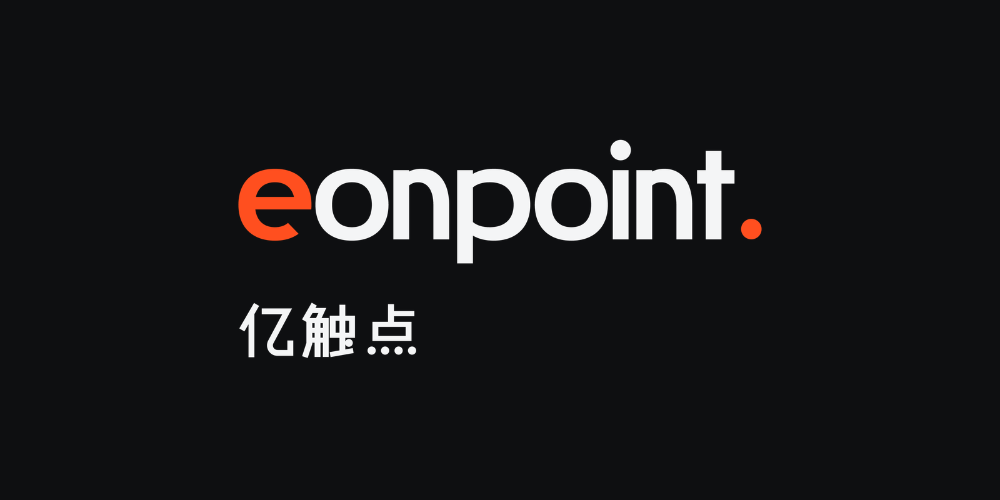
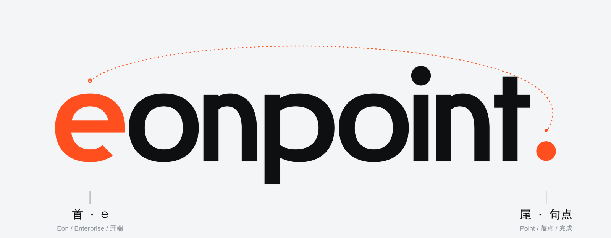
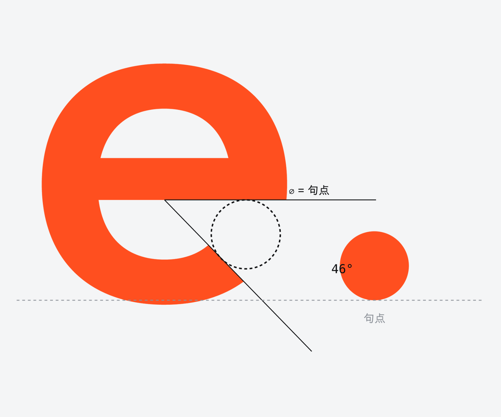
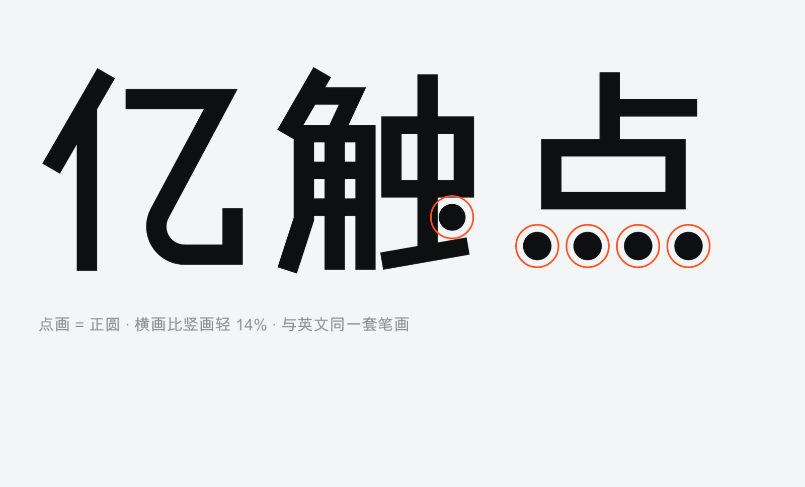
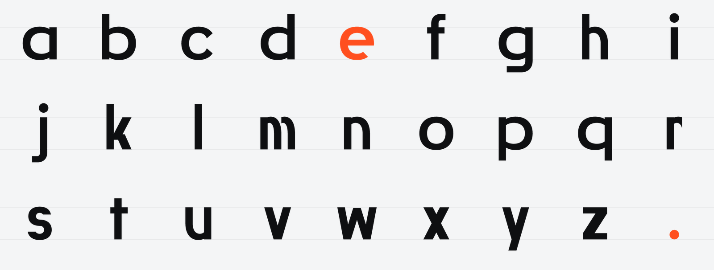
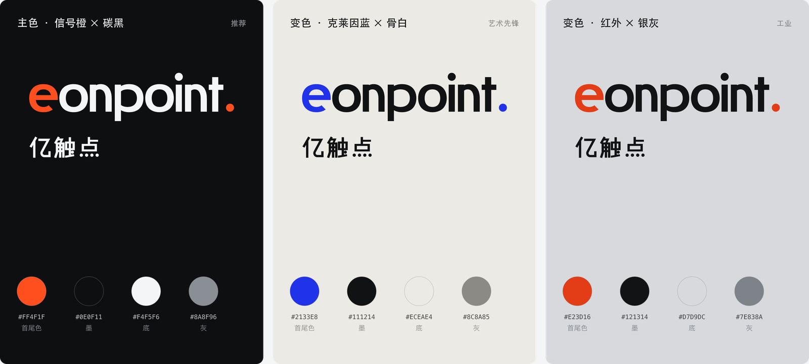
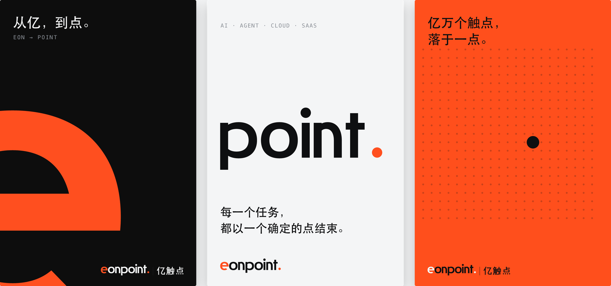
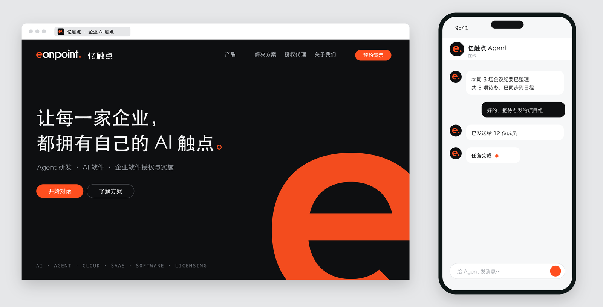

<div align="center">



**English** · [中文](README.zh-CN.md)


</div>

**DanLogo · Swiss Tech (静几何)** is an [Agent Skill](https://agentskills.io) that lets AI tools such as Claude and Codex design **complete logo identity systems** in a precise, type-led, Swiss-rooted tech spirit: custom bilingual lettering as the mark, a symbol combined from it, colour, the system, scenes, the proposal and the delivery files. It holds every mark to one idea: **the word becomes one designed shape, and the symbol is taken from the word.**

> 字是图形，取字成符；安静、准确，像一句话说到最后一个字。

It is part of the danlogo series: the same nine-stage workflow and quality gates as its siblings, a different style.

---

## The style

Swiss Tech is a **type-led** style: the mark is custom Latin and Chinese lettering, constructed until the word reads as a designed shape, and the icon is made by **combining or reshaping elements taken from the lettering itself**. It is defined at the level of form language — not which letters, not which colour — and it is not tied to any industry.

**Core relation — the word becomes one shape; the symbol is taken from the word.** One or more elements of the wordmark (a letter, part of a letter, a punctuation mark, a stroke) are put side by side, overlapped, nested, joined, cropped, or cut and shifted into a compact, solid symbol. The same signal marks those elements in the wordmark and in the symbol, and a measurable relation binds them.

| Locked form language | What it means | Kindred works (for understanding, not copying) |
|---|---|---|
| **Constructed, not written** | Letters built from geometric parts; a–z and the Chinese share one set of parts | Bayer's universal alphabet; Crouwel's *New Alphabet*; DIN 1451 |
| **Corrected geometry** | Curves between circle and square, continuous curvature, one squareness for everything | Piet Hein's superellipse; continuous-curvature icons |
| **Module and datum** | One base unit generates every glyph and the symbol | Le Corbusier's *Modulor*; Swiss grids |
| **Quiet body, one signal** | Neutral letters; one or two signal elements separated into graphics | Mobil's single coloured letter; Newman's *Onement I* |
| **Correction as character** | Ink-trap thinning, flat terminals, overshoot — one enlarged into a signature | Bell Centennial; contemporary display type |

**Why it feels modern, trendy and tech** — not from effects, but from construction: constructed letters (industrial, systematic); lowercase geometric sans (open, contemporary); continuous curvature (the curve language of screens and devices); ink traps and flat cuts (engineering detail turned display-type trend); neutral + one signal colour (the language of hardware indicators); a word with one lit part (the name carries its own icon and UI state); parametric consistency (software-like); few elements, flat, crisp at 16 px; Latin and Chinese built as one.

Its thinking draws on the Bauhaus type experiments, concrete poetry, Swiss International Style, the classic modernist logotypes that turned letters into images, the optical-correction and parametric traditions of type design, and the colour discipline of functionalist products.

## How it works

Nine stages, and you sign off on every one:

**1 Brief → 2 Concepts (5 per round) → 3 Prototypes (≥3 per concept, black and white) → 4 Refine → 5 Finalize (custom lettering + colour) → 6 System → 7 Scenes → 8 Proposal → 9 Retrospective**

- **Concepts** read the name's letterforms and meaning — openings, rounds, dots, repeats, strokes Latin and Chinese can share — and list at least ten combination candidates before choosing; each concept is one way of combining letters into a symbol.
- **Prototypes** fix the type's grammar first (datum, squareness, terminals, ink traps), then draw key letters and the symbol; they must pass the style's four "letters as graphics" questions and silhouette, reverse and 16 px review boards.
- **Refine** writes every proportion as a rule in code: the signal is calculated, not nudged.
- `decisions.md` records every round, so a project can continue in another session or another AI.

## Case: EonPoint 亿触点 · Bookends

The style was reverse-engineered with danlogo-maker (the series' style-decoding skill) from a real, client-approved identity for **EonPoint 亿触点**, an AI services company. It is the source of the style's type-led approach: what new projects borrow is the method — construct the letters, make a symbol from them — not these letters.



<sub>The word becomes one shape; the symbol is taken from it. Here the head <b>e</b> and the closing full stop are lit and combined into the icon <b>e.</b> — the start and the end of a sentence (“from countless possibilities (eon) to one definite point”). This combination is this brand's answer; each new name finds its own.</sub>

 

<sub>The hidden rule: the opening of the e is computed to hold exactly one full stop. The Chinese lettering shares the same engineering; its dot strokes are true circles.</sub>









<sub>Every scene lights only one place. In the agent chat, a finished task ends with the signal.</sub>

Full case: [`cases/eonpoint-shouwei/case.md`](cases/eonpoint-shouwei/case.md). New projects may not reuse its motif or the specific arrangement of its core relation.

## Install

```bash
git clone https://github.com/dan-cube/danlogo-swisstech.git
cd danlogo-swisstech
./install.sh            # Claude Code (~/.claude/skills) and Codex (~/.agents/skills)
```

- One tool only: `./install.sh claude` or `./install.sh codex` (restart Codex afterwards).
- claude.ai: `./install.sh package`, then upload `dist/danlogo-swisstech.skill` in the skills settings.
- No skill installed? Paste [`PROMPT-CARD.md`](PROMPT-CARD.md) into any AI.

## Use

Just ask, for example: *“Use the Swiss Tech style to design a logo for Farboat, an industrial software company.”* In Codex you can call `$danlogo-swisstech`. If several danlogo styles are installed and you name none, the agent asks which one first.

## What's inside

```
SKILL.md                      entry: positioning, three layers of requirements, nine stages
PROMPT-CARD.md                the style as one card for any AI
references/                   4 style chapters + 5 shared danlogo-core chapters
cases/eonpoint-shouwei/       the real case, with the client's own words
examples/eonpoint-shouwei/    full generator code for the case (learn the engineering, not the forms)
scripts/                      geometry & SVG, review boards, sheets, rendering, mock-ups (Python stdlib)
adapters/                     Claude vs Codex differences
evals/briefs.md               test briefs: same style, different forms
```

## Updating

Edit in this repository, then `git pull && ./install.sh`. At the end of every project (stage 9) the agent asks whether to fold it back in as a case or rule change, and writes nothing without your approval. The five `danlogo-core` chapters are maintained by the series standard in danlogo-maker.

## Notes

The EonPoint name, marks and case images belong to their owner and are shown only to illustrate the method; they are not licensed for reuse.
