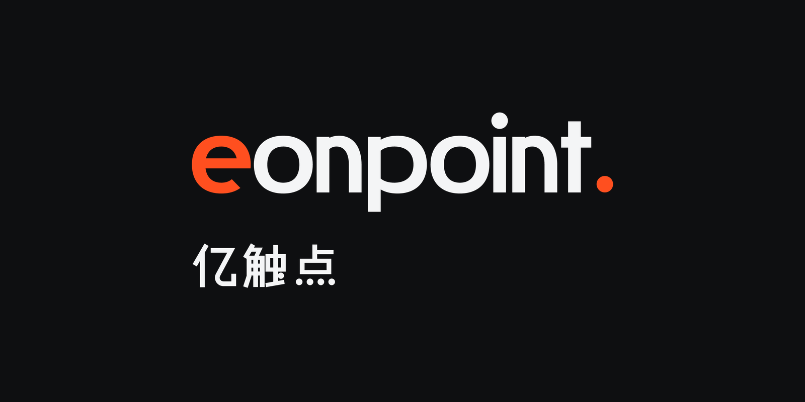
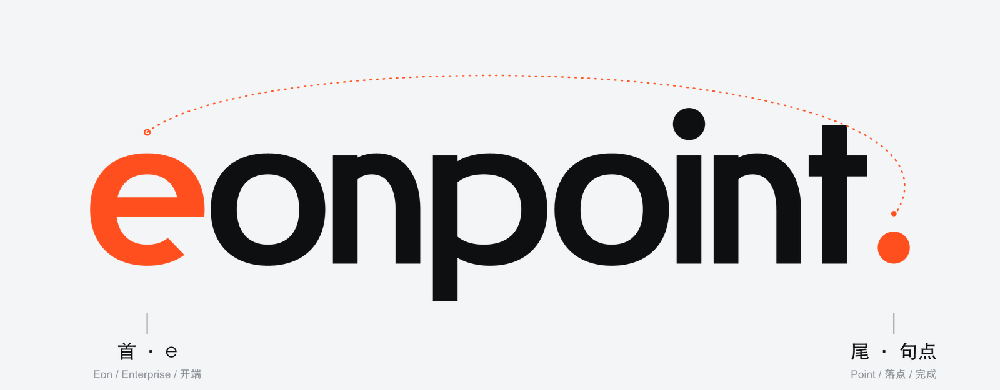
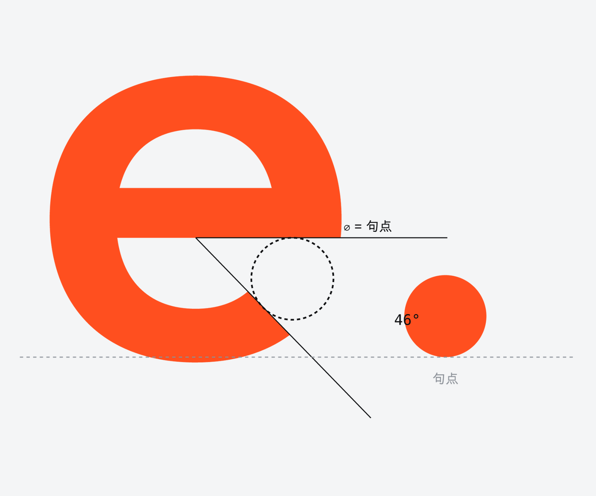
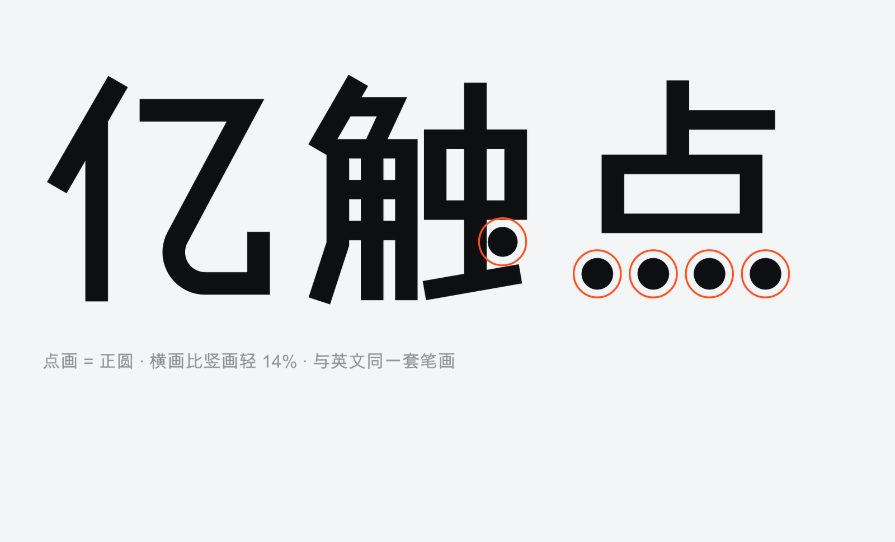
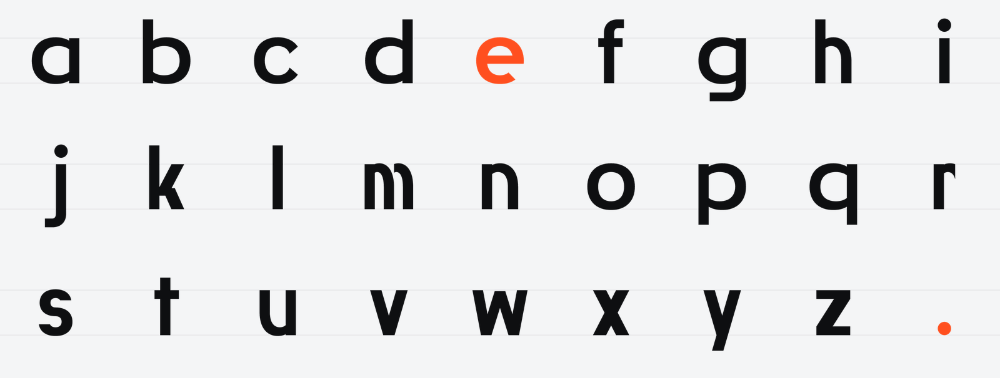
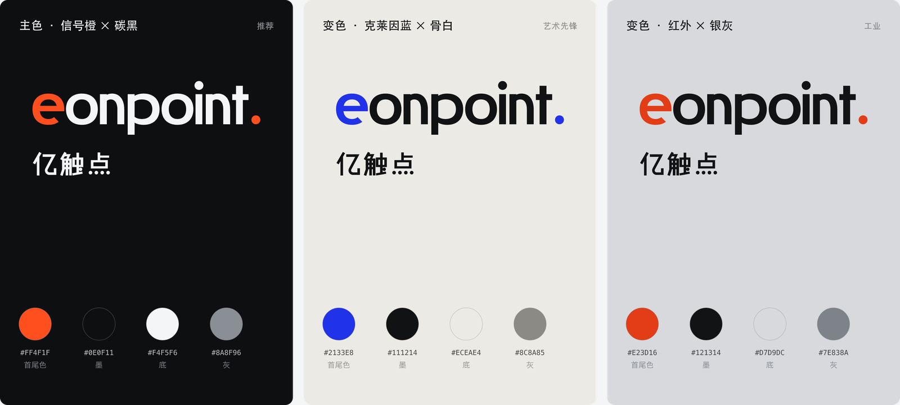
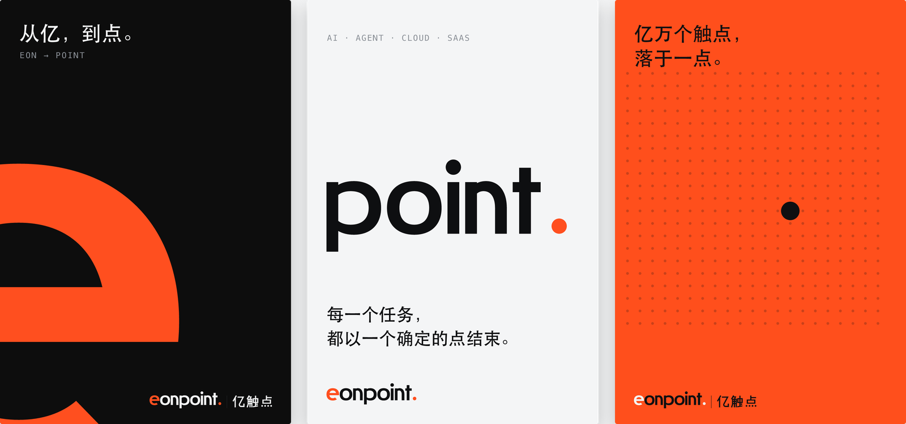
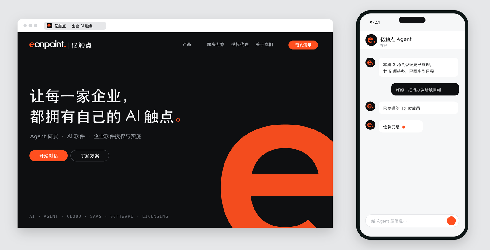

<div align="center">



[English](README.md) · **中文**

</div>

**DanLogo · 静几何 Swiss Tech** 是一个 [Agent Skill](https://agentskills.io)：让 Claude、Codex 等 AI 工具以精确、以字为标、源自瑞士理性的科技气质，做成套的 logo 与品牌标志体系——中英文定制字标、从字里组合出的符号、配色、体系、场景、提案与交付文件。它对每一个标志只有一个要求：**字成一体，取字成符。**

> 字是图形，取字成符；安静、准确，像一句话说到最后一个字。

它属于 danlogo 系列：与其他风格共用同一套九阶段流程和质量关卡，只换风格。

---

## 风格

静几何是一种**以字为标**的风格：标志由从零定制的中英文字形构成，字被构造到整个词读成一个被设计的形；图标由**从字标里取一处或几处元素组合、改造**而成。它锁定的是形式语言，不规定用哪几个字母、什么颜色，也不限行业。

**核心构成——字成一体，取字成符。** 从字标里取一处或几处元素（字母、字母的一部分、标点或笔画），用并置、叠合、嵌套、连写、截取等方式组合，或把一个字形切开错位，做成一个紧凑、有面的符号；同一种信号同时标出字标里的这几处和符号，几处之间由一条量得出的关系绑定。

| 锁定的形式语言 | 意思 | 同一路的知名作品（帮助理解，不照搬） |
|---|---|---|
| **构造，不书写** | 字由几何零件构造；a–z 与中文共用一套零件 | 拜耳的通用字体；克劳威尔《新字母表》；DIN 1451 |
| **修正几何** | 曲线介于圆与方之间，曲率连续，全套一个方度 | 皮特·海恩的超椭圆；连续曲率的图标 |
| **模数与基准** | 一个基准生成全部字形与符号 | 勒·柯布西耶《模度》；瑞士网格 |
| **大静小响** | 中性字形大面积，一两处信号把被组合的元素分离成图形 | 美孚字标里唯一上色的字母；纽曼《合一 I》 |
| **修正即性格** | 墨阱式刀口、平切端头、出格，其中一处放大成签名 | Bell Centennial；当代展示字体 |

**现代感、潮流感、科技感从哪里来**——不是来自效果，而是来自构造：构造字（工业化、系统化的语言）；小写几何无衬线（开放、当代）；连续曲率（屏幕与设备的曲线语言）；墨阱与平切（工程细节成为展示字体的潮流）；中性 + 一处信号色（硬件指示灯的语言）；词中分色（名字自带图标与界面状态）；参数化一致（像软件）；极少元素、平面、16 px 清楚；中英同构。

思想来自包豪斯的构造字、具体诗、瑞士国际主义、把字变成图形的现代主义经典字标、字体设计的视觉修正与参数化，以及功能主义产品的信号色。

## 怎么工作

九个阶段，每一步都等你确认：

**1 简报 → 2 概念（每轮 5 套）→ 3 原型（每个概念 ≥3 套，先黑白）→ 4 图形精修 → 5 定稿（定制字 + 配色）→ 6 体系 → 7 场景 → 8 提案 → 9 总结**

- **概念**读名字的字形与意思——开口、圆、点、重复、中英可共用的笔画——先列 10 个以上组合候选再挑；每个概念是一种把字组合成符号的方式。
- **原型**先定字的语法（基准、方度、端头、刀口），再画关键字母与符号；要通过本风格的“字形图形化四问”和剪影、反白、16 px 审看板。
- **精修**把每个比例写成代码里的规则：信号是算出来的，不是挪出来的。
- `decisions.md` 记录每一轮，项目可以换会话、换 AI 继续。

## 案例：EonPoint 亿触点 ·「首尾」

本风格用 danlogo-maker（系列的风格逆向 skill）从一个真实的、客户确认过的品牌标志反向拆解而来：AI 服务公司 **EonPoint 亿触点**。它是本风格“以字为标”的来源：新项目借的是方法——把字构造好，从字里取一处或几处做成符号——不是这几个字母。



<sub>字成一体，取字成符：开头的 <b>e</b> 与结尾的句点被点亮，并组合成图标 <b>e.</b>——一句话的开始与完成（“从亿万种可能，落到一个确定的点”）。这个组合是这个名字的答案；每个新名字要找到自己的组合。</sub>

 

<sub>隐藏的规则：e 的开口经过计算，刚好容下一个句点。中文字标出自同一套工程，点画是正圆。</sub>









<sub>每个场景只点亮一处。在 Agent 对话里，完成的任务以信号收尾。</sub>

完整案例：[`cases/eonpoint-shouwei/case.md`](cases/eonpoint-shouwei/case.md)。新项目不能沿用它的母题和核心关系的具体安排。

## 安装

```bash
git clone https://github.com/dan-cube/danlogo-swisstech.git
cd danlogo-swisstech
./install.sh            # 同时装到 Claude Code（~/.claude/skills）和 Codex（~/.agents/skills）
```

- 只装一个：`./install.sh claude` 或 `./install.sh codex`（Codex 需重启后生效）。
- claude.ai：`./install.sh package`，把 `dist/danlogo-swisstech.skill` 上传到技能设置。
- 没有安装 skill 时：把 [`PROMPT-CARD.md`](PROMPT-CARD.md) 贴给任何 AI。

## 使用

直接说需求，例如：“用静几何的风格，给『远舟』这家工业软件公司做一个 logo。”在 Codex 里可以用 `$danlogo-swisstech` 显式调用。装了多个 danlogo 风格又没有点名时，AI 会先问你用哪一个。

## 目录

```
SKILL.md                      入口：定位、三层要求、九个阶段
PROMPT-CARD.md                风格提示词卡
references/                   风格四章 + danlogo-core 共用五章
cases/eonpoint-shouwei/       真实案例，含客户原话
examples/eonpoint-shouwei/    案例的完整生成代码（学工程写法，不学造型）
scripts/                      几何与 SVG、审看板、对比图、渲染、场景示意（Python 标准库）
adapters/                     Claude 与 Codex 的差异
evals/briefs.md               测试简报：风格一致、形式不同
```

## 更新

在本仓库里修改，然后 `git pull && ./install.sh`。每个项目结束时（第 9 阶段），AI 会询问是否把它作为案例或规则调整沉淀进来，你批准后才写入。五个 `danlogo-core` 共用章节由 danlogo-maker 里的系列标准统一维护。

## 说明

EonPoint 的名称、标志与案例图片归其所有者，仅用于说明方法，不授权复用。
