# 案例：EonPoint 亿触点「首尾」

> **只借方法，不借形式。** 这里的字形、颜色、首字母与句点、开口的角度，都是 EonPoint 的答案，不是静几何的规定。
> 本案是静几何“以字为标”的源头：字从零构造，符号从字里组合而来。新项目借方法，不借这几个字母和这种组合。

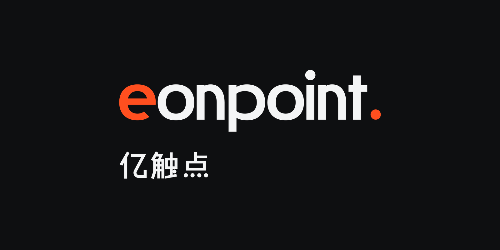

## 简报

- **品牌**：EonPoint 亿触点，一家做 AI 服务的科技公司。
- **业务**：AI Agent 研发；企业软件的授权代理与实施。To B。
- **业务说明**：AI · Agent · Cloud · SaaS · Software · Licensing
- **出发点**：一张 AI 生成的参考稿——衬线体 `EonPoint.`，i 的点和句点为橙色，米白底。
- **用户原话**：“我喜欢他这种对于‘点’的核心概念的把控，但是我总觉得不够成熟，符号化不强，艺术潮流感不高，整体不像一个成熟的 logo，而是过于 AI 味和拼搭感……让他更具备 AI 硅谷大厂的 logo 气质。”

## 过程

| 轮 | 做了什么 | 用户原话 / 决定 | 教训 |
|---|---|---|---|
| 1 | 诊断原稿：两个橙点分散焦点；现成衬线体与“米白 + 珊瑚橙”是 AI 生成设计的常见配方；中英割裂；点没有规则。提出三个方向：A 句点（小写字标）、B 触点（字母 E 的中横伸出成一处）、C 亿点（点阵字母） | 选 A，并提出“用字母制作 Logo，最简约的图形应取自字母首尾呼应的结构。那么，在字母 Logo 中，E 是否也应变为单独的颜色？” | 用户想要的“成熟”是一个想法加一条规则，而不是更多图形 |
| 2 | A 的三个变体：A1 首尾（首字母与句点同色）、A2 开合（只点亮句点，首尾靠字形呼应）、A3 轻重（按词义分两种灰度）。设计师推荐 A2 | “用 A1 的首尾吧。”“其他字母的设计也平庸了，是否可以整体设计一下，让整个字体都统一的设计感。”“目前色系似乎有点点幼稚明亮……我不要老土的商务风，但是我需要更加硅谷国际化的科技风或者更加艺术潮流先锋的色系。” | 首尾两端用同一信号相认，比只点亮一端更有力；一个字母精彩、其余平庸不可接受 |
| 3 | 26 个小写字母按同一套规则重画；中文字标同构；配色改为碳黑 + 信号橙，另备克莱因蓝与红外两套变色；做体系、场景、25 页提案 | 认可 | 冷中性 + 一个纯信号，比暖米色更有国际科技感 |
| 4 | 查重：最接近的是一家德国能源公司的红色小写字标（名字同源 aeon）；字标加句点是常见手法；首尾同色与整套规则未见先例 | “先保持现状，我自己判断后再定。” | 第 3、5 阶段就要查“行业头部的颜色 + 首字母”这类组合 |

被否或未选的方向与原因：
- B 触点、C 亿点：用户选了更接近原稿的小写方向。
- A2 开合：只点亮结尾，首尾呼应只靠字形，用户觉得不够明确。
- A3 轻重：分色按词义，削弱了“首尾”的故事。
- 暖米色 + 柿橙的配色：用户认为“幼稚明亮”。

## 最终方案

- **概念**：首尾。名字 = eon（亿、万古）+ point（点）——“从亿万种可能，落到一个确定的点”。小写 `eonpoint.`：开头的 e 与结尾的句点同为信号色，一头一尾像一句话的开始与完成；图标 `e.` 是两端合在一起。
- **隐藏的规则**：e 的开口角度经过计算，以横画下沿为起点，刚好容下一个与句点同大的圆。开端为收尾留出位置。
- **字形**：所有圆形是同一族超椭圆；拱与碗接竖笔处收细；端头平切；横细竖粗；只有“点”是正圆。26 个字母都按这套规则画出。
- **中文**：直线段构成，去笔锋；横比竖细；“触”的点与“点”的四点画成正圆，与英文句点同源。
- **色彩**：碳黑与冷灰为主，信号橙只给两端；变色：克莱因蓝配骨白、红外配银灰。

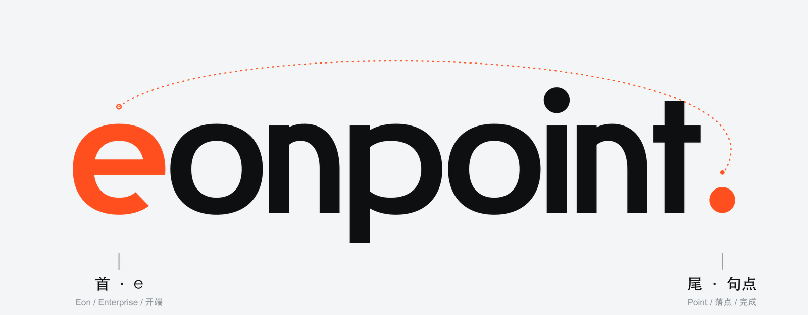
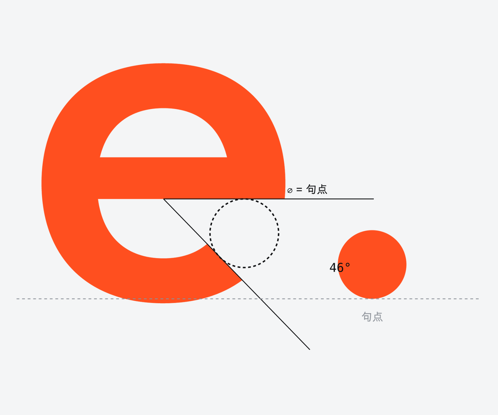
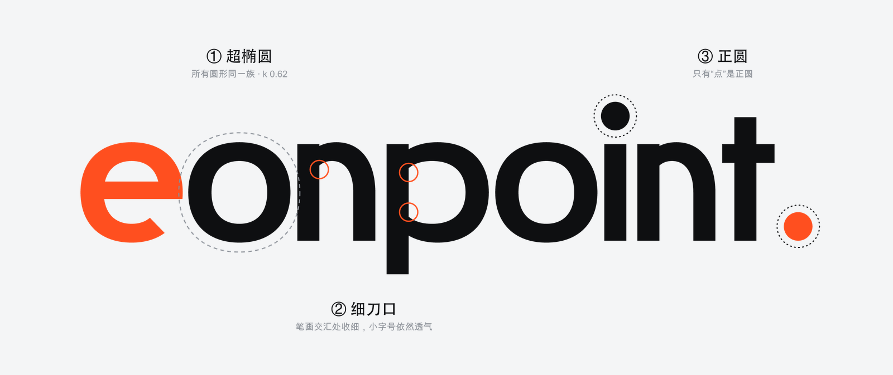
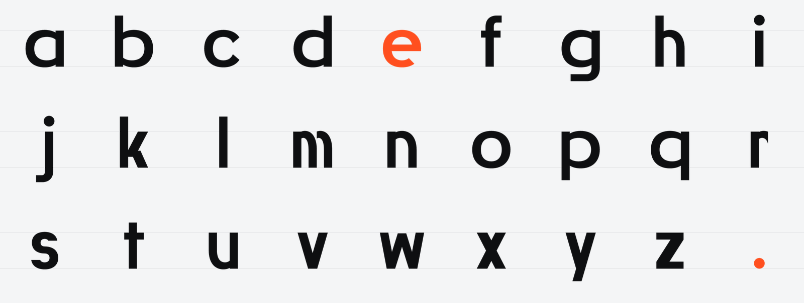
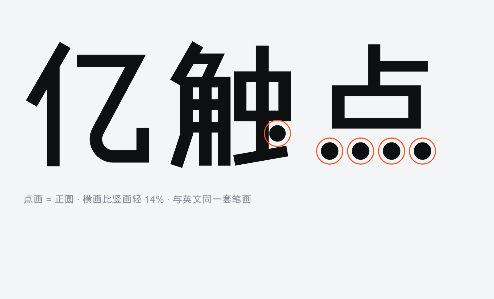

## 反向拆解对照表

| 风格要求 | 在本案中的体现 |
|---|---|
| 字成一体（核心） | 9 个小写字形按一套几何语法构造，整个词读成一个形；26 个字母全部推出 |
| 取字成符（核心） | 首字母 e 与句尾句点被取出，组合成图标 `e.` |
| 关系算得出 | e 的开口按句点直径计算 |
| 修正几何 | 所有圆形是同一族超椭圆（圆与方之间），转角与端头统一 |
| 模数与基准 | 全部字形从竖笔宽一个基准推出 |
| 色彩分离 | 碳黑与冷灰的字形，信号橙只标首字母与句点 |
| 标点与笔画成为图形元素 | 只有“点”是正圆，其余圆形是超椭圆 |
| 修正即性格 | 拱与碗接竖笔处明显收细；端头平切 |
| 理性的体温 | 小写与略圆的超椭圆 |
| 一套工程语言 | 中文点画即正圆，与英文同源 |

## 旋钮取值

组合方式：首字母加标点（首尾并置）· 大小写：全小写 · 方度：偏圆（超椭圆指数约 2.2）· 信号：一对，颜色 · 签名修正：交接收细 · 力度：中 · 温度：冷 · 信号色：偏红的橙 · 字：小写几何 · 材料：工业涂层与屏幕 · 构图：横向。

## 可以借的方法

- 先定一个基准，所有尺寸从它推出。
- 全图只用一个方度，曲线与转角出自同一种构造。
- 让信号的尺寸由主体的规则推出。
- 给元素按意义排纯度，只让最重要的那一个最纯。
- 单色版本里，让重点由纯度与位置保住。
- 体系里的辅助图形从标志的构成长出来；每个场景只点亮一处。

## 体系与场景

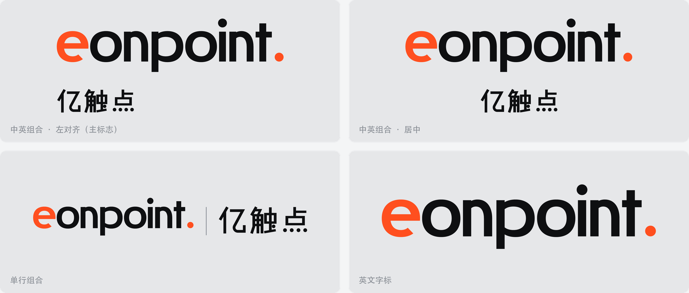
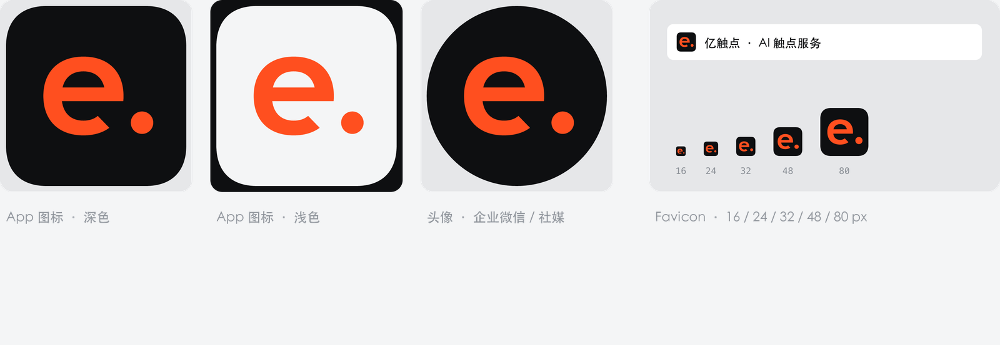
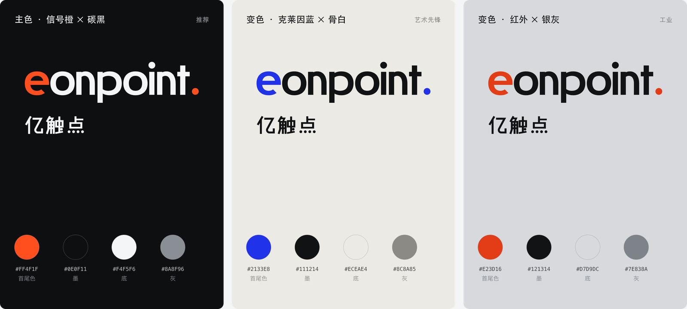
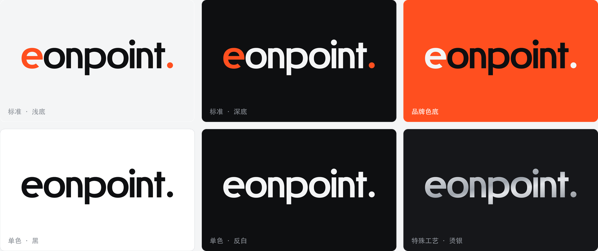
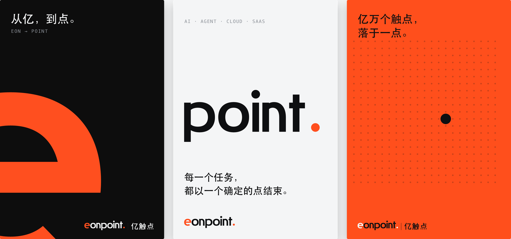
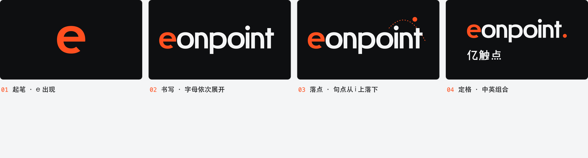
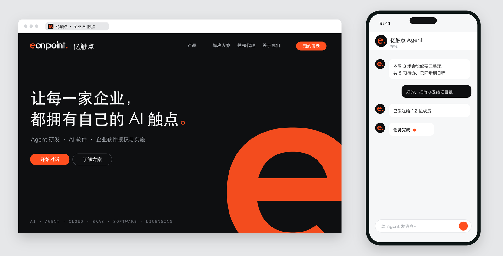
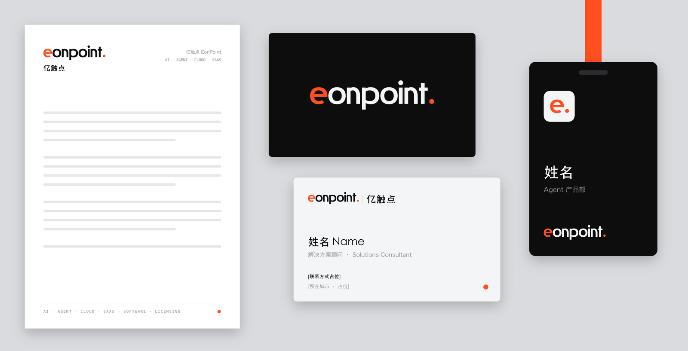
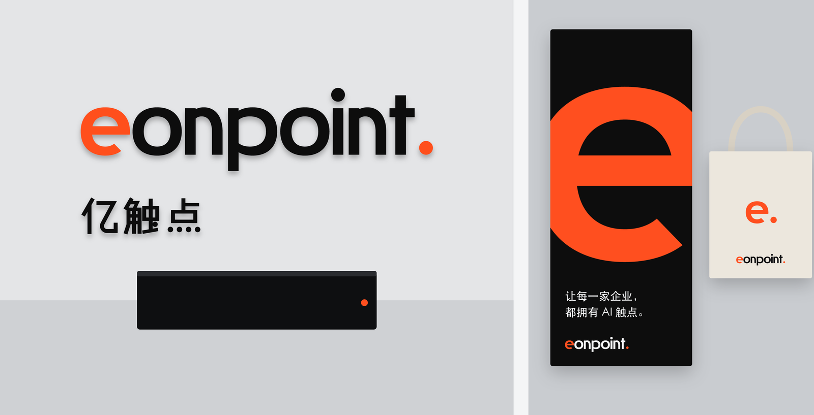

## 查重结论

- 最接近：一家德国能源公司的红色小写字标（名字同源 aeon，近年焕新时引入了红色圆点元素）。风险集中在单独使用的红橙色首字母图标与“红外”变色；用户决定暂时保持现状。
- 字标加句点是常见手法（多家互联网与科技公司用过），不能单独作为识别点。
- 未见先例：首尾同色、整套字母的规则、中文点画即正圆。
- 网络检索不等于商标检索；正式使用前应由商标代理按类别检索。

## 文件

- `images/`：定稿与体系、场景的展示图（真实完成的作品）。
- `../../examples/eonpoint-shouwei/src/`：全部生成代码（字母表、字标、中文、组合与色彩模式、规范图、场景图、导出）。
